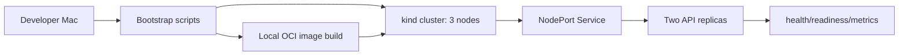

# Local Kubernetes Platform Architecture

## Engineering decisions

- **Provisioning:** Declarative kind cluster configuration for reproducible local workloads without cloud spend.
- **Delivery:** Local Docker build and image load, Kustomize base/overlay declarative manifests; no paid registries.
- **Reliability:** Two replicas, rolling updates with `maxUnavailable: 0`, readiness/liveness probes and disruption budget.
- **Security:** Restricted namespace, non-root UID, seccomp RuntimeDefault, dropped Linux capabilities, read-only root filesystem, no privilege escalation.
- **Observability:** HTTP health/readiness and Prometheus-compatible telemetry endpoint. No Prometheus server has been installed.
- **Autoscaling:** HPA specified but requires metrics-server, absent by default in kind.
- **Automation:** Bash scripts for bootstrap/check/smoke/teardown; GitHub CI configuration for Python tests and container build.

## Boundaries and gaps

The local 3-node kind topology is not high availability for the physical host. It does not prove cloud IAM, production networking, multi-zone durability or realistic load. An external TLS ingress, persistent data, distributed tracing and end-to-end fault-injection tests are not yet implemented.

## Evidence

Four application HTTP tests passed in the authoring environment. Docker/kind runtime validation is still pending on the target Mac; see `docs/RUNBOOK.md`.
